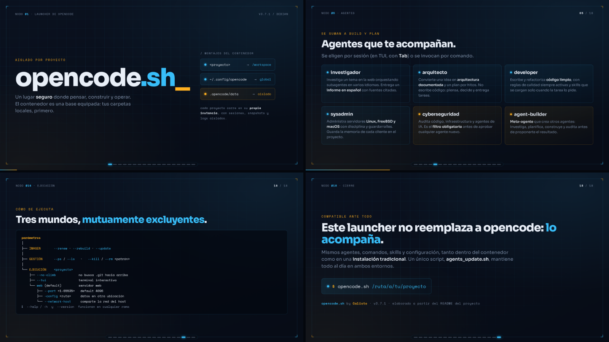
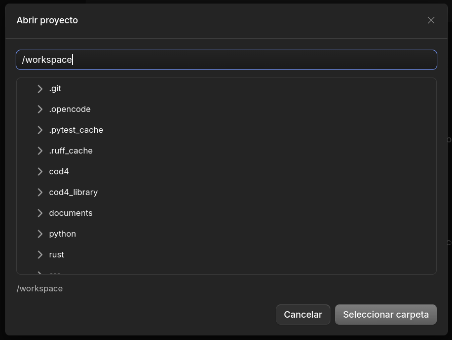

<!-- SPDX-FileCopyrightText: 2026 Daniel Zipitría (Calisto) -->
<!-- SPDX-License-Identifier: CC-BY-SA-4.0 -->

# opencode-container

Un lugar seguro donde pensar, construir y operar con [opencode](https://opencode.ai):
el mismo opencode que ya conocés, pero dentro de un contenedor Debian aislado por
proyecto, con las herramientas ya dispuestas y tus carpetas locales siempre a la mano.

> **Compatibilidad ante todo.** Este launcher no reemplaza a opencode: lo acompaña.
> Los agentes, comandos, skills y configuraciones que viajan acá se despliegan igual
> de bien en el contenedor como en una instalación tradicional de opencode.

---

## Presentación

<a href="https://www.cilan.com.uy/blog/opencode-container/raw">
  
</a>

Un recorrido visual por el proyecto: qué aporta, los agentes especializados que lo acompañan,
la seguridad opcional por kernel y cómo se ejecuta. **[Abrir la presentación](https://www.cilan.com.uy/blog/opencode-container/raw)** o **[Ver el código fuente](opencode-container-readonly.html)** — HTML autocontenido,
se abre directamente en el navegador.

## Por qué existe este proyecto

Cuando trabajamos en una idea, no queremos que la máquina local sea parte del
experimento. Instalar toolchains, pelear con versiones, mezclar credenciales o
dejar rastros en el sistema son distracciones que rompen el ritmo. La motivación de
este proyecto es simple: **darte un espacio aislado, reproducible y completo para
trabajar con opencode**, sin sacrificar nada de lo que ya ofrece la versión
tradicional.

El contenedor es una base equipada. Trae preinstaladas las herramientas de
desarrollo, redes, automatización y seguridad que solés necesitar, así no tenés que
ensuciar tu máquina ni empezar de cero cada vez. Y como todo el estado vive en tu
proyecto (no en el sistema), podés entrar y salir sin miedo: tu entorno local queda
tal como estaba.

## Instalación rápida — si estás apurado

> ¿Llegaste con el reloj corriendo y sólo querés que funcione, ya? No leas
> 900 líneas: andá directo al **[QUICKSTART.md](QUICKSTART.md)** — clone,
> construcción de la imagen, agentes, credenciales, primer arranque y los dos
> ajustes de la web. El detalle técnico sigue acá abajo, para cuando se calmen
> las cosas (o para cuando algo se rompa y busques el porqué).

## Qué te llevás

- **Un opencode completo y familiar**: mismos agentes base (`build`, `plan`) y toda
  la configuración global compartida entre proyectos.
- **Cuatro entornos de programación integrados**: Python, JavaScript, TypeScript y
  Rust, listos para usar sin instalación previa.
- **Herramientas de apoyo ya presentes**: diagnóstico de redes, DevOps, control de
  versiones, automatización y auditoría.
- **Agentes especializados** que se suman a los de opencode para cubrir las tareas
  del día a día, desde la investigación hasta la operación de servidores.
- **Seguridad opcional por kernel**: el agente `sysadmin` puede desplegar
  `landlock_rosh` para dejar un servidor remoto en solo lectura, incluso para
  root, cuando la tarea es diagnosticar y no tocar.
- **Tus carpetas locales, primero**: el contenedor trabaja sobre tus directorios
  reales; nada de islas desconectadas.
- **Un solo flujo de actualización** para el contenedor y para opencode tradicional.

## Cuatro entornos, un mismo espacio

| Entorno | Qué encontrás |
|---------|---------------|
| **Python** | Python 3, pip y `python3-dev` para extensiones nativas. El venv canónico vive en `<proyecto>/python/`, se crea y activa solo, y el type checking corre con pyright. Ruff disponible como linter/formatter. |
| **JavaScript** | Node.js y npm para scripts, paquetes del ecosistema y soporte de lenguaje vía LSP. |
| **TypeScript** | El mismo toolchain de Node.js más el soporte de TypeScript que opencode activa a través de su LSP integrado. |
| **Rust** | Toolchain estable vía rustup, con objetivo `x86_64-unknown-linux-musl` para binarios estáticos. Registry, `target/` y binarios quedan aislados en `<proyecto>/rust/`. |

Además: `git`, `ssh` y `gpg`; `curl`, `wget` y `jq` para APIs; `iptables` y Ansible
para automatización y configuración remota; y una caja de redes con `ping`,
`traceroute`, `mtr`, `dig`, `ss`, `nmap`, `tcpdump` y `tshark`.

## Agentes que te acompañan

Además de `build` y `plan`, este proyecto incorpora agentes pensados para cubrir
frentes concretos. Se eligen por sesión (en TUI, con `Tab`) o se invocan por comando.

| Agente | Para qué sirve |
|--------|----------------|
| `investigador` | Investiga un tema en la web orquestando subagentes en varios idiomas y entrega un informe en español, con fuentes citadas, listo para leer o convertir a PDF y HTML con estilos predefinidos. |
| `arquitecto` | Convierte una idea en arquitectura documentada y un plan de trabajo por hitos. No escribe código: piensa, decide y entrega tareas. |
| `developer` | Escribe y refactoriza código limpio y mantenible, con reglas de calidad siempre activas y skills que se cargan solo cuando la tarea lo pide. |
| `sysadmin` | Administra servidores Linux, FreeBSD y macOS con disciplina y guardarraíles de seguridad, guardando la memoria de cada cliente en el proyecto. |
| `cyberseguridad` | Audita código, infraestructura y agentes de IA. Es el filtro de seguridad obligatorio antes de dar por aprobado cualquier agente nuevo. |
| `agent-builder` | Meta-agente que crea otros agentes: investiga, planifica, construye y audita antes de proponerte el resultado. |

Además de los agentes, el proyecto distribuye **skills globales** sin agente portador.
La principal es `frontend-slides`: crea presentaciones HTML autocontenidas y animadas desde
cero o convirtiendo un PowerPoint, con descubrimiento visual de estilo y 34 plantillas
"bold", y exporta el resultado a PDF localmente. Sus dependencias vienen integradas en
la imagen. Se invoca con el comando `/frontend-slides`.

### Cómo se construyeron

Algunos agentes nacieron de una idea propia, como el `investigador`. Otros, como el
`arquitecto`, se levantaron con `agent-builder`: un asistente que usó al
`investigador` para rastrear repositorios públicos en español, inglés, francés,
alemán, ruso y chino, seleccionar las fuentes más adecuadas y complementarias, y
vendorizar el agente a partir de ellas. Cada pieza pasó después por el agente de
`cyberseguridad` para asegurar que el agente y sus skills no contuvieran, por
ejemplo, prompt injection y que sus permisos fueran seguros.

Ese mismo rigor es reproducible: cada agente documenta el procedimiento para
actualizarse desde sus fuentes originales, de modo que el trabajo pueda repetirse y
mantenerse en el tiempo.

## Delegar trabajo a un subagente: `/hand-off`

La idea es **ahorrar tokens**: en vez de arrastrar toda esta conversación hacia otra tarea, se
escribe un encargo acotado y lo resuelve un subagente que sólo ve ese encargo.

El comando global `/hand-off` arma ese encargo y lo delega:

```text
/hand-off developer arreglá el redirect del login tras el 401
/hand-off            # modo seguro: pregunta agente y tarea
```

Qué hace:

- escribe una **hoja de ruta autocontenida** en
  `<proyecto>/.opencode/handoffs/<fecha>-<slug>.md`: objetivo, contexto mínimo, alcance
  (incluye / no incluye), pasos con criterio de aceptación y verificación, definición de
  terminado y rollback. Está pensada para que la lea alguien sin nada del historial de
  esta sesión;
- la delega a un **subagente** con la tool `subagent`: el agente elegido corre como sesión
  hija, lee la hoja, ejecuta el plan y devuelve su informe **acá mismo**, así que no hay
  link que abrir. El modo se elige al disparar: en **primer plano** bloquea esta
  conversación hasta terminar; en **segundo plano** la deja libre y el resultado llega como
  mensaje, pero si el subagente necesita una decisión o un permiso puede quedar esperando
  sin avisar (hay que abrir su sesión en el listado de subagentes para verlo), y el comando
  imprime ese riesgo antes de lanzar;
- antes de disparar escanea la hoja en busca de secretos: si aparece algo con forma de
  clave, la línea se redacta y el disparo no ocurre hasta que el escaneo esté limpio.

Si el subagente necesita una decisión, no abre un formulario —el invocador no puede
contestarte en el medio—: devuelve la pregunta como texto, el comando la pasa al humano y
continúa la misma conversación hija con su `sessionID`. En segundo plano eso pasa cuando
llega el mensaje del subagente al terminar.

Las hojas no se acumulan: se conservan 14 días o 10 archivos como máximo, se pide
confirmación antes de borrar, y la hoja disparada queda en disco para el barrido del
próximo `/hand-off` o para un pedido manual.

Es un comando, no un agente: se invoca desde cualquier sesión y usa el agente que elijas.
Si la tarea viene de un issue, un mail o cualquier texto que no escribiste vos, invocalo
**sin argumentos**: en ese modo el comando pregunta agente y tarea y no recibe nada por
línea de comandos.

Una salvedad: si invocás el comando desde `arquitecto`, su permiso de delegación sólo
permite `investigador*` y `explore`; para delegar a otro agente, hacelo desde una sesión con
`developer`, `cyberseguridad`, `investigador`, `sysadmin` o `agent-builder`.

## Informes listos para compartir

Los agentes generan Markdown, y el proyecto incluye `md2pdf`, una herramienta que
convierte cualquier informe a **PDF o HTML** con estilos agradables para lectura y
publicación: `github`, `pandoc`, `newsprint`, `notion` y `paper`. Las tablas se
maquetan según el contenido de cada columna (auto-layout) y cortan las palabras
largas, tanto en PDF como en HTML. Está disponible como comando global `/md2pdf`.

## Seguridad que no depende del prompt: `landlock_rosh`

Un agente puede equivocarse: un `rm` de más, un `sed -i` sobre el archivo
equivocado, un `chmod` que no era. `landlock_rosh` existe para que ese error no
llegue al servidor: encierra la sesión remota en una jaula **read-only impuesta
por el kernel** (Landlock + seccomp), incluso para root.

Es un **add-on opcional** del agente `sysadmin`, no un requisito del launcher.
Se ofrece cuando pedís acceso de solo lectura o en un host crítico; si no se
pide, no se despliega. La sesión sigue sirviendo para leer logs, estado de
servicios, discos, red y todo lo que no implique escribir.

**Qué aporta**

- **Barrera real, no una promesa:** bloquea escrituras, borrados, `chmod`,
  `chown` y `truncate` directos; también a root.
- **Dos modos honestos:** `ro` (jaula real) y `log` (permite escribir y deja
  traza; no protege).
- **Integración transparente:** `command=".../landlock_rosh"` en
  `authorized_keys`; el cliente no elige el modo.
- **Auditoría:** journald o archivo con rotación; comando, usuario, IP y exit
  code.
- **Límites claros:** es una barrera de *filesystem*. No bloquea daemons
  (`systemctl`, `docker`, `gluster`), señales, netlink ni `touch -m`. Para eso
  hace falta una allowlist o un modo write-guarded (futuro).

**Cómo se instala (manual, en 30 segundos)**

En el contenedor ya está: `/usr/local/bin/landlock_rosh` viaja en la imagen como
*payload*; se ejecuta en el servidor remoto, no en tu máquina. En opencode
tradicional:

```bash
./src/agents_update.sh --install-tools      # deja landlock_rosh en ~/.local/bin
```

En el servidor remoto (esto es lo que la skill hace por vos):

```bash
BIN=$(command -v landlock_rosh || echo "$HOME/.local/bin/landlock_rosh")
scp "$BIN" usuario@host:/tmp/
ssh usuario@host 'sudo install -m 755 /tmp/landlock_rosh /usr/local/bin/'
ssh usuario@host 'sudo /usr/local/bin/landlock_rosh --install-log'
# imprime la línea; pegala en authorized_keys reemplazando la de esa clave
"$BIN" --print-ssh-line --pubkey ~/.ssh/id_ed25519.pub
```

El flujo completo —con backup, reemplazo atómico de la línea y verificación— lo
hace el agente con la skill `calisto-landlock` y `scripts/pin-key.sh`. Pedile al
sysadmin que "deje este host read-only" y te muestra el plan y el rollback antes
de tocar nada.

**Por qué importa:** el agente puede elegir no escribir. El kernel no negocia.

Límites y verificación: `src/tools/landlock/README.md` (tool) y
`src/agents/sysadmin/skills/calisto-landlock/references/` (procedimiento del
agente). El add-on se preserva en las actualizaciones de heinzel
(`src/agents/sysadmin/ADDONS.md`).

## Problemas conocidos

Dos molestias de la **interfaz web** de opencode que aparecen al arrancar con un
proyecto nuevo. La TUI (`--tui`) no las tiene: ahí la carpeta y el selector de
agentes están siempre presentes. Son del cliente web de opencode, no del
launcher; acá queda el workaround para no perder tiempo buscándolo.

**La carpeta del proyecto no aparece en la lista**

El contenedor siempre trabaja sobre `/workspace`: es ahí donde se monta la
carpeta que le pasaste al launcher, y es ahí donde vive el historial de sesiones
(`/workspace/.opencode/`). La primera vez que entrás a un proyecto con un puerto
propio (`--port`), la web puede no mostrarlo y hay que agregarlo a mano:

Clic en el ícono de proyectos.


En la sección **Proyectos**, elegí agregar uno nuevo para abrir el diálogo.
   **Abrir proyecto** 


Escribí `/workspace` —la ruta *dentro* del contenedor, no la del host— y
   confirmá con **Seleccionar carpeta**.

.

A partir de ahí el proyecto queda registrado y las sesiones se listan solas.

**No aparece la sección de agentes para cambiar de agente**

No es un bug de permisos ni de configuración de los agentes: la web trae
desactivada por defecto la opción que muestra ese selector en el editor. Se
habilita una sola vez:

Entrá a **Ajustes**.


En el panel derecho, activá **Mostrar agente**.


El propio texto de la opción lo aclara: *"Cambiar de agente en el editor. Si se
oculta, se usa el agente Build de forma predeterminada"*. Mientras esté apagada,
todo corre con `build` y los agentes instalados parecen no existir.

**Por qué no se parchea**

Ambos problemas fueron reportados varias veces en el proyecto de opencode y
cerrados por los bots por falta de actividad. Parchear el código iría contra la
premisa del proyecto: opencode se conserva tal cual y el valor se agrega
**alrededor** —contenedor, agentes, skills, herramientas—, lo que mantiene la
compatibilidad y transparencia al 100% con opencode tradicional y permite seguir sus versiones sin
mantener un fork. Mientras tanto, estos dos clics son el precio de la web. Y en general son
necesarios 1 sola vez por puerto de la interfaz web que uses.

## Compatibilidad y actualización

Este desarrollo se esfuerza por mantenerse **completamente compatible con opencode
tradicional**. Un único script, `agents_update.sh`, se encarga de actualizar los
agentes, las skills, los estilos y los comandos, tanto para el launcher
contenedorizado como para una instalación tradicional de opencode.

La diferencia es mínima:

- **En el contenedor**, las herramientas (`md2pdf`, `landlock_rosh`, etc.) ya
  vienen integradas en la imagen.
- **En opencode tradicional**, las herramientas se instalan de forma explícita
  con `./agents_update.sh --install-tools`.

El flujo de deploy y actualización es el mismo en ambos casos y se describe en
detalle más abajo, en [Agentes personalizados](#agentes-personalizados-deploy-y-actualización).

## Identidad del agente

El launcher crea una **identidad propia para el agente**, separada de la del usuario:

- Una **llave SSH** que podés usar en servidores remotos sin exponer tu llave personal.
- Un **`gitconfig`** que define el autor de los commits del agente y que podés
  personalizar.

Ambas viven en `~/.config/opencode/identity/` y se enlazan dentro del contenedor al
iniciar. Así los commits y accesos del agente quedan claramente diferenciados de los
tuyos.

---

# Especificaciones técnicas

A partir de acá, el detalle operativo: comandos, montajes, variables y flujo de
actualización. Es la referencia para usuarios técnicos y también una ayuda-memoria
para los propios agentes.

## Cheatsheet

| Acción | Comando |
|--------|---------|
| Modo web (puerto 4096) | `opencode.sh /ruta/a/tu/proyecto` |
| Modo TUI | `opencode.sh /ruta/a/tu/proyecto --tui` |
| Modo web explícito | `opencode.sh /ruta/a/tu/proyecto --web` |
| Modo vía variable de entorno | `OPENCODE_GUI=tui opencode.sh /ruta/a/tu/proyecto` (o `OPENCODE_GUI=web`) |
| Puerto personalizado | `opencode.sh /ruta/a/tu/proyecto --port 4097` |
| Puertos extra publicados | `opencode.sh /ruta/a/tu/proyecto --extra-ports 3000,8080` |
| Auth básica web | `opencode.sh /ruta/a/tu/proyecto --password "pwd"` (usuario: `opencode`; default: `opencode`) |
| Link de acceso (pairing) | `opencode.sh --pair 4096` (o `--pair opencode-4096`) |
| Alta/rotación de la API key canónica | `opencode.sh --credentials-set opencode-go` (prompt oculto) |
| Compartir el login de un proyecto | `opencode.sh --credentials-export /ruta/a/tu/proyecto` |
| Datos en otra ubicación | `opencode.sh /ruta/a/tu/proyecto -config /mnt/opencode-data` |
| Compartir red del host | `opencode.sh /ruta/a/tu/proyecto --network-host` |
| Listar contenedores | `opencode.sh --ps` (o `--ls`) |
| Detener contenedor | `opencode.sh --kill <patrón>` (o `--rm <patrón>`) |
| Reconstruir imagen (caché) | `opencode.sh --rebuild` |
| Actualizar imagen (no-cache) | `opencode.sh --update` |
| Actualizar desde cero y reemplazar | `opencode.sh --renew` |
| Sincronizar agentes/skills/comandos | `./src/agents_update.sh` |
| Instalar tools en host tradicional | `./src/agents_update.sh --install-tools` |

## Prerrequisitos

- [Podman](https://podman.io/) instalado (≥ 4.0 para los *cache mounts* del `Containerfile`)
- Linux o macOS

## Instalación rápida

```bash
git clone <url-del-repo>
cd opencode-container
chmod +x opencode.sh
```

### Acceso cómodo desde cualquier carpeta

Conviene crear un enlace simbólico a `opencode.sh` dentro de un directorio que ya
esté en tu `PATH` (por ejemplo `~/.local/bin` o `~/bin`). Así podés lanzarlo desde
cualquier proyecto sin escribir la ruta completa:

```bash
ln -s "$(pwd)/opencode.sh" ~/.local/bin/opencode.sh
```

### Disponibilizar los agentes en tu entorno

El código de los agentes, skills, estilos y comandos vive en el repo; para que
opencode los vea hay que desplegarlos a la configuración global del usuario
(`~/.config/opencode/`). Es el mismo directorio que lee el opencode tradicional y que
monta el contenedor, así que **un solo paso cubre ambos entornos**:

```bash
# Desde el repo, desplegar agentes + skills + estilos + comandos (pide confirmación)
./src/agents_update.sh

# Ver primero qué cambiaría, sin escribir nada
./src/agents_update.sh --check
```

Reiniciá opencode (contenedor o tradicional) para que tome los agentes.

> **Solo para opencode tradicional (no el contenedor):** las herramientas de software
> como `md2pdf` y `landlock_rosh` no vienen preinstaladas y hay que instalarlas
> explícitamente:
>
> ```bash
> ./src/agents_update.sh --install-tools          # a ~/.local/bin
> ./src/agents_update.sh --install-tools ~/bin    # a un directorio propio
> ```
>
> Una vez instalada, `md2pdf` puede requerir dependencias extra de Python
> (`markdown` y `weasyprint`). Verificalo con el diagnóstico integrado, que además
> muestra las instrucciones de instalación según tu sistema operativo:
>
> ```bash
> md2pdf --doctor
> ```
>
> `landlock_rosh` es un binario estático Linux x86_64 sin dependencias: en macOS
> no se ejecuta localmente, pero sirve para copiarlo a servidores Linux remotos.
> En el contenedor todas las herramientas y sus dependencias ya están integradas
> en la imagen, por lo que ni `--install-tools` ni `--doctor` son necesarios.

## Uso

> **Es obligatorio pasarle una carpeta local.** El contenedor no es una isla: monta
> tu directorio y trabaja directamente sobre él. La carpeta de trabajo por defecto
> dentro del contenedor es **`/workspace`**, y corresponde al proyecto que pasás
> como argumento.

```bash
# Modo web (puerto 4096 por defecto)
./opencode.sh /ruta/a/tu/proyecto

# Modo TUI (terminal interactiva)
./opencode.sh /ruta/a/tu/proyecto --tui

# Modo web explícito (es el modo por defecto)
./opencode.sh /ruta/a/tu/proyecto --web

# Modo vía variable de entorno del host (los flags --tui/--web ganan)
OPENCODE_GUI=tui ./opencode.sh /ruta/a/tu/proyecto

# Puerto personalizado
./opencode.sh /ruta/a/tu/proyecto --port 4097

# Publicar puertos extra del contenedor en el host (aplica en web y TUI)
./opencode.sh /ruta/a/tu/proyecto --extra-ports 3000,8080

# Auth básica web (usuario fijo: opencode)
./opencode.sh /ruta/a/tu/proyecto --password "mi-secreto"

# Datos del proyecto en ubicación personalizada
./opencode.sh /ruta/a/tu/proyecto -config /mnt/opencode-data

# Subcarpeta de un proyecto git (resuelve la raíz buscando .git hacia arriba)
./opencode.sh /ruta/a/tu/proyecto/subdir

# Forzar a trabajar exactamente en la subcarpeta sin buscar .git
./opencode.sh /ruta/a/tu/proyecto/subdir --no-climb
```

En modo web el contenedor corre **detached** (`podman run -d`): el comando vuelve,
el contenedor sigue vivo y el launcher imprime el password y un link de acceso de
un solo uso. Detenelo con `./opencode.sh --kill <puerto>`; los logs se siguen con
`podman logs -f opencode-<puerto>`. Para pedir links nuevos (por ejemplo, para la
LAN), usá `./opencode.sh --pair <puerto>`.

### Gestión de imagen

| Acción | Comando |
|--------|---------|
| Reconstruir imagen (con caché) | `./opencode.sh --rebuild` |
| Actualizar imagen (no-cache + pull base) | `./opencode.sh --update` |
| Actualizar imagen desde cero, reemplazando la anterior si el build es exitoso | `./opencode.sh --renew` |
| Compartir red del host | `./opencode.sh /path/to/project --network-host` |
| Auth básica web | `./opencode.sh /path/to/project --password "pwd"` (usuario: `opencode`) |

> `--renew` y `--rebuild` son mutuamente excluyentes.

### Gestión de contenedores

| Acción | Comando |
|--------|---------|
| Listar contenedores opencode en ejecución | `./opencode.sh --ps` o `./opencode.sh --ls` |
| Detener un contenedor opencode (nombre exacto) | `./opencode.sh --kill opencode-tui2` |
| Detener un contenedor opencode (forma corta) | `./opencode.sh --kill tui2` o `./opencode.sh --kill 2` |
| Detener un contenedor opencode (por puerto) | `./opencode.sh --kill 4096` |
| Alias de `--kill` | `./opencode.sh --rm <patrón>` |
| Generar links de acceso (pairing) | `./opencode.sh --pair 4096` o `./opencode.sh --pair opencode-4096` |

> `--ps`/`--ls`, `--kill`/`--rm`, `--pair` y `--kill-all` son mutuamente excluyentes
> y no se pueden combinar con flags de gestión de imagen ni de ejecución.
> `--pair` lee el password del contenedor: no acepta `--password` ni `--port`.

### Credenciales compartidas

Opencode v2 guarda las credenciales en SQLite, dentro de la base **de cada proyecto**
(`opencode.db`). El launcher mantiene `~/.config/opencode/share/auth.json` como fuente
canónica y la siembra en cada proyecto al arrancar (`opencode-credentials seed`).

| Acción | Comando |
|--------|---------|
| Alta o rotación de una API key | `./opencode.sh --credentials-set opencode-go` |
| Promover un login hecho en la TUI | `./opencode.sh --credentials-export ./proyecto` |
| Aplicar el canónico a un contenedor vivo | `./opencode.sh --sync-credentials 4096` |
| Proyecto con credenciales propias | `./opencode.sh ./proyecto --no-credentials-seed` |

Precedencia: un login hecho a mano en el proyecto gana (override local) y no se
propaga hasta correr `--credentials-export`; una credencial sembrada con key vieja se
reemplaza en el siguiente arranque. Sólo se comparten API keys: las credenciales OAuth
no, porque sus refresh tokens rotan y compartirlos invalidaría los logins de otros
proyectos.

#### Cómo se propaga

```
--credentials-set (o editar el JSON a mano)
        │
        ▼
~/.config/opencode/share/auth.json        fuente canónica (0600, una entrada por integración)
        │   en cada arranque de contenedor
        ▼
entrypoint.sh → opencode-credentials seed
        │
        ▼
<proyecto>/.opencode/data/opencode.db     tabla `credential` (una base por proyecto)
```

`--sync-credentials <patrón>` hace ese mismo `seed` en un contenedor que ya está
corriendo (`podman exec`), sin reiniciarlo.

| Estado de la base del proyecto | Qué hace el seed |
|---|---|
| No tiene la integración | la importa |
| Ya tiene esa key (aunque el id difiera) | no-op |
| Tiene una credencial sembrada por el launcher, con key vieja | la borra y la reimporta (rotación) |
| Tiene un login hecho a mano en la TUI | no la toca (override local) |

Verificación dentro del contenedor:

```bash
podman exec opencode-4096 opencode auth list               # "OpenCode Go  API key  stored"
podman exec opencode-4096 opencode models | grep -c opencode-go/
```

## Combinaciones de parámetros

Los parámetros se distribuyen en cuatro **mundos mutuamente excluyentes**:

- **Mundo IMAGEN**: `--renew` / `--rebuild` / `--update` — gestionan la imagen del contenedor.
- **Mundo GESTIÓN**: `--ps` / `--ls` / `--kill` / `--rm` / `--pair` — operan sobre contenedores en ejecución.
- **Mundo CREDENCIALES**: `--credentials-set` / `--credentials-export` / `--sync-credentials` — mantienen el `auth.json` canónico.
- **Mundo EJECUCIÓN**: `<proyecto>` + flags runtime (`-config`, `--port`, `--extra-ports`, `--tui`, `--web`, `--network-host`, `--no-credentials-seed`) — lanzan un contenedor.

Los flags de un mundo **no se cruzan** con los del otro. La referencia formal completa
(tabla única, BNF y reglas del parser) está en [`PARAMETERS.md`](PARAMETERS.md).

### Árbol de combinaciones

```
ℹ️  --help / -h es compatible con cualquier rama (short-circuits y sale)
ℹ️  --version imprime la versión del launcher y sale

parámetros
│
├── --renew                          actualiza la imagen reconstruyendo desde cero;
│                                    elimina la anterior si el build es exitoso
│
├── --rebuild                        reconstruye imagen usando caché
│
├── --update                         actualiza imagen desde cero
│
├── --ps | --ls                      muestra contenedores opencode en ejecución
│
├── --kill <patrón> | --rm <patrón>  detiene un contenedor opencode
│       (patrón: opencode-tui2, opencode-4096, tui2, 2, 4096)
│
├── --pair <patrón>                  genera links de acceso para un contenedor web
│       (mismo patrón que --kill; lee el password del contenedor)
│
├── --credentials-set <integración>  escribe la API key en share/auth.json (0600)
│
├── --credentials-export <proyecto>  promueve las API keys del proyecto al canónico
│
├── --sync-credentials <patrón>      aplica el canónico en un contenedor en ejecución
│
└── <proyecto>                       lanza opencode en el proyecto
    │
    ├── --no-climb                   desactiva la búsqueda de .git hacia atrás
    │                                (también: --no-search-git)
    │
    ├── --no-credentials-seed        no siembra auth.json al arrancar
    │
    ├── --tui                        arranca terminal interactiva
    │   ├── -config <ruta>
    │   ├── --network-host
    │   └── --extra-ports <n>,<n>,...   publica puertos extra host→contenedor
    │
    └── web (default)                arranca servidor web
        ├── --web                    fuerza modo web (gana a OPENCODE_GUI)
        ├── --port <1-65535>
        │   └── default: 4096
        ├── --extra-ports <n>,<n>,...   publica puertos extra host→contenedor
        ├── -config <ruta>
        └── --network-host
```

### Reglas clave

- No mezclar flags de mundos distintos (IMAGEN/GESTIÓN/CREDENCIALES/EJECUCIÓN).
- `--renew` y `--rebuild` son mutuamente excluyentes (error del script).
- `--ps`/`--ls`, `--kill`/`--rm`, `--pair` y `--kill-all` son mutuamente excluyentes entre sí.
- `--credentials-set`, `--credentials-export` y `--sync-credentials` son mutuamente excluyentes entre sí; sólo el export acepta `<proyecto>` y `-config`.
- `--pair` usa el mismo patrón que `--kill`; no acepta `--port` ni `--password` (los lee del contenedor).
- `--tui` ignora `--port` (no hay servidor web).
- `--tui`/`--no-web` y `--web` son mutuamente excluyentes.
- Selección de modo (precedencia): flags `--tui`/`--no-web` o `--web` > env
  `OPENCODE_GUI` del host (`tui`/`web`; valor inválido → aviso y default) >
  default web.
- `--extra-ports <n>,<n>,...` publica `-p n:n` por cada puerto, en web y TUI
  (comas sin espacios, 1-65535, sin duplicados ni choque con `--port` en web).
- `--no-climb` (alias `--no-search-git`) desactiva la resolución automática de `.git`
  hacia arriba; útil para trabajar en una subcarpeta aislada.
- `--network-host` omite `-p` (puerto web y extra-ports: podman los descarta
  al compartir la red del host).
- Contenedores TUI se nombran `opencode-tuiN` (numeración `max+1`).
- Contenedores web se nombran `opencode-<puerto>` y corren detached (`-d`):
  sobreviven al cierre de la terminal; se detienen con `--kill <puerto>`.
- Password web: `--password` > env `OPENCODE_SERVER_PASSWORD` > default
  `opencode`; se imprime al arrancar en modo web.

### Ejemplos de invocaciones válidas

```bash
# Mundo IMAGEN
./opencode.sh --renew
./opencode.sh --update

# Mundo GESTIÓN
./opencode.sh --ps
./opencode.sh --ls
./opencode.sh --kill opencode-tui2
./opencode.sh --kill 4096
./opencode.sh --rm tui2
./opencode.sh --pair 4096
./opencode.sh --pair opencode-4096

# Mundo EJECUCIÓN — web
./opencode.sh /ruta/proyecto
./opencode.sh /ruta/proyecto/subdir               # busca .git hacia arriba para encontrar la raíz del proyecto
./opencode.sh /ruta/proyecto/subdir --no-climb    # no busca la raíz; trabaja en la subcarpeta
./opencode.sh /ruta/proyecto --port 4097 --network-host
./opencode.sh /ruta/proyecto -config /mnt/data
./opencode.sh /ruta/proyecto --web                # fuerza modo web (default)
OPENCODE_GUI=web ./opencode.sh /ruta/proyecto     # modo web vía env del host
./opencode.sh /ruta/proyecto --extra-ports 3000,8080

# Mundo EJECUCIÓN — TUI
./opencode.sh /ruta/proyecto --tui
./opencode.sh /ruta/proyecto --tui --network-host
OPENCODE_GUI=tui ./opencode.sh /ruta/proyecto     # modo TUI vía env del host
./opencode.sh /ruta/proyecto --tui --extra-ports 3000   # puertos extra también en TUI
```


## Arquitectura

### Separación de datos

| Alcance | Ubicación (host) | Contenido |
|---------|-------------------|-----------|
| **Global** | `~/.config/opencode/` | `opencode.json` (API keys), `agents/`, `commands/`, `identity/`, `share/` |
| **Por proyecto** | `<project>/.opencode/` | `data/` (opencode.db con sesiones, mensajes y credenciales; snapshots, logs), `state/` (locks) |
| **Por proyecto (raíz)** | `<project>/python/` | Venv canónico (venv-first, auto-creado/activado por `entrypoint.sh`, gitignoreado) |
| **Por proyecto (raíz)** | `<project>/rust/` | `CARGO_HOME`/`CARGO_TARGET_DIR`: `registry/`, `target/`, `bin/` de cargo (aislado, gitignoreado) |

### Montajes en el contenedor

| Host | Contenedor | Alcance |
|------|------------|---------|
| `<project>` | `/workspace` | Proyecto |
| `~/.config/opencode/` | `/home/opencode/.config/opencode/` | Global |
| `~/.config/opencode/identity/` | `/root/.identity` | Global |
| `~/.config/opencode/share/` | `/home/opencode/.local/share/opencode-global/` | Global |
| `<project>/.opencode/data/` | `/home/opencode/.local/share/opencode/` | Proyecto |
| `<project>/.opencode/state/` | `/home/opencode/.local/state` | Proyecto |

### Symlinks internos (creados por entrypoint.sh)

Dentro del contenedor, `entrypoint.sh` crea symlinks en `/home/opencode/.local/share/opencode/`:

| Symlink | Destino |
|---------|---------|
| `auth.json` | `/home/opencode/.local/share/opencode-global/auth.json` |
| `db/` | `/home/opencode/.local/share/opencode-global/db/` |
| `repos/` | `/home/opencode/.local/share/opencode-global/repos/` |

> En opencode v2 el symlink de `auth.json` ya **no** comparte credenciales: sólo sirve
> como semilla del import legacy, que corre una única vez por base. La compartición real
> la hace `opencode-credentials seed` en cada arranque.

## Configuración

La configuración global vive en `~/.config/opencode/` y no se ve afectada por `-config`:

| Ruta | Propósito |
|------|-----------|
| `opencode.json` | API keys, proveedores, modelos, permisos |
| `agents/` | Agentes personalizados |
| `commands/` | Comandos personalizados |
| `identity/` | Git/ssh identity del agente |
| `share/auth.json` | Credenciales canónicas: se siembran en la base de cada proyecto al arrancar |
| `share/db/` | Cuentas OAuth (GitHub, GitLab, Copilot, etc.) |
| `share/repos/` | Clones internos |

## Agentes personalizados: deploy y actualización

Los agentes personalizados viven como **copia canónica** en `src/agents/<agente>/`
(fuente de verdad, versionada en git; una subcarpeta por agente) y se propagan a la
configuración global (`~/.config/opencode/agents/`) con `src/agents_update.sh`.

El script se ejecuta **solo desde el repo** (resuelve su propia ruta, no necesita
instalación), **no modifica `opencode.sh`** y su resultado es el mismo para el
contenedor y para opencode tradicional: la config global se monta dentro del
contenedor y también es leída por cualquier instalación local de opencode.

**Deploy (layout híbrido por rol de archivo):** el dueño (`<agente>/<agente>.md`
o un archivo en la raíz) se copia plano a `~/.config/opencode/agents/<agente>.md`,
y cualquier otro archivo de la carpeta (subagente) conserva su ruta, por ejemplo
`src/agents/investigador/investigador-en.md` →
`~/.config/opencode/agents/investigador/investigador-en.md`. El layout **no
depende de `mode:`**: un dueño puede ser `primary` o `all`. OpenCode V2 escanea
`{agent,agents}/**/*.md` **recursivamente** y deriva el ID de la ruta relativa;
**el campo `name:` del frontmatter se ignora**. Así los dueños tienen nombres
limpios (`investigador`) y los subagentes conservan la pertenencia
(`investigador/investigador-en`). **No hace falta registro** en `opencode.json`:
el directorio global `agents/` se lee solo. Los dueños anidados del layout viejo
se respaldan y se eliminan durante la migración.

### Un solo script, cinco etapas

`agents_update.sh` gestiona cinco etapas y pide una confirmación por etapa:

| Etapa | Origen (repo) | Destino (global) |
|-------|---------------|------------------|
| **agents** | `src/agents/**/*.md` | `~/.config/opencode/agents/<agente>.md` (primario) / `<agente>/<subagente>.md` |
| **skills** | `src/agents/*/skills/<nombre>/**` | `~/.config/opencode/skills/<nombre>/` |
| **styles** | `src/tools/css-styles/**` | `~/.config/opencode/css-styles/` |
| **commands** | `src/commands/*.md` | `~/.config/opencode/commands/` |
| **tools** | `src/tools/*` (raíz, p.ej. `md2pdf.py`, `landlock_rosh`) | `~/.local/bin` (solo con `--install-tools`) |

La etapa **tools** es la única diferencia entre entornos: en el contenedor `md2pdf`,
`landlock_rosh` y los estilos ya vienen horneados en la imagen, mientras que en opencode
tradicional se instalan explícitamente con `--install-tools`.

Reglas del script:

- Solo gestiona los agentes bajo `src/agents/` (todos con `version: N` en el frontmatter).
  **Nunca** toca los agentes por defecto de OpenCode (`build`, `plan`, etc.) ni borra
  otros agentes que tengas instalados.
- Compara contra las copias instaladas usando `version:` + `sha256sum` (archivos en
  disco, sin git ni red).
- Muestra primero qué agentes cambiaron, advierte que se reemplazarán (las ediciones
  locales se pierden, el respaldo es responsabilidad del usuario) y pide confirmación
  (`Y`/`s`).

```bash
# Instalar/actualizar agentes, skills, estilos y comandos (pide confirmación)
./src/agents_update.sh

# Ver qué cambiaría, sin tocar nada
./src/agents_update.sh --check

# Aplicar sin confirmación (deploy desatendido)
./src/agents_update.sh --force

# Omitir una etapa concreta
./src/agents_update.sh --no-skills      # agents + styles + commands
./src/agents_update.sh --no-styles      # agents + skills + commands
./src/agents_update.sh --no-commands    # agents + skills + styles

# Instalar SOLO las tools en opencode tradicional (default: ~/.local/bin)
./src/agents_update.sh --install-tools

# Ayuda
./src/agents_update.sh --help
```

Para actualizar un agente: editá los `.md` en `src/agents/<agente>/`, subí su `version:`
y corré el script. El registro completo está en `src/agents/README.md`.

### Alcance global y local

Además del deploy global (default), `agent-builder` soporta **alcance local**: agentes,
skills y commands desarrollados en `/tmp` y copiados a `<proyecto>/.opencode/{agents,skills,commands}/`
(`/workspace/.opencode/...` dentro del contenedor), versionados en el git del proyecto.
El scope local no pasa por `agents_update.sh`.

## Variables de entorno del contenedor

| Variable | Valor | Propósito |
|----------|-------|-----------|
| `XDG_CONFIG_HOME` | `/home/opencode/.config` | Raíz de configuración |
| `XDG_STATE_HOME` | `/home/opencode/.local/state` | Raíz de estado (locks) |
| `XDG_DATA_HOME` | `/home/opencode/.local/share` | Raíz de datos (auth, storage, snapshots) |
| `VIRTUAL_ENV` | `/workspace/python` | Venv del proyecto (lo setea `entrypoint.sh` si `python/` es un venv) |
| `CARGO_HOME` | `/workspace/rust` | Registry/bin de cargo por proyecto |
| `CARGO_TARGET_DIR` | `/workspace/rust/target` | Artefactos de build de cargo por proyecto |
| `RUSTUP_HOME` | `/root/.rustup` | Toolchain de Rust (en la imagen, global) |
| `AGENT_GIT_NAME` | `OpenCode Agent` | Nombre git del agente |
| `AGENT_GIT_EMAIL` | `agent@opencode.local` | Email git del agente |
| `OPENCODE_MODE` | `web` / `tui` | Modo de ejecución |
| `OPENCODE_SERVER_PASSWORD` | — | Password de auth básica web (si no se usa `--password`). El usuario siempre es `opencode` |

### Variables del host que lee el launcher

Estas variables se leen en el host al lanzar `opencode.sh` y no requieren flags:

| Variable | Valores | Propósito |
|----------|---------|-----------|
| `OPENCODE_GUI` | `tui` / `web` | Selecciona la interfaz si no se pasan flags `--tui`/`--web` (los flags ganan; valor inválido → aviso y default web). No llega al contenedor: el launcher la resuelve a `OPENCODE_MODE` |
| `OPENCODE_PERMISSION` | JSON inline | Permisos de opencode; tiene prioridad sobre `--auto`/`--no-auto` |

## Red

Por defecto, el contenedor usa el namespace de red propio de Podman (slirp4netns/pasta),
por lo que **no puede acceder a servicios que escuchen en `127.0.0.1` del host** (ej: una
BD local, un proxy LLM).

Usa `--network-host` para agregar `--network host` a `podman run`: el contenedor comparte
la red del host y `localhost` dentro del contenedor resuelve al host. Esto **rompe el
aislamiento de red**, así que úsalo solo cuando sea necesario.

En modo web con `--network-host`, el puerto se publica automáticamente vía la red del host,
por lo que se omite el flag `-p`.

Puertos extra: `--extra-ports <n>,<n>,...` publica cada puerto del contenedor en el mismo
puerto del host (`-p n:n`), además del puerto web. Aplica en **ambos modos** (web y TUI) —
útil para alcanzar servicios que corran dentro del contenedor (ej: un dev server que el
agente levante). Formato: números separados por comas sin espacios, mínimo 1, cada uno
entre 1 y 65535, sin duplicados ni choque con `--port` (en modo web). Con `--network-host`
se omite con aviso: al compartir la red del host, los puertos del contenedor ya son
directamente puertos del host.

## Auth básica web

El servidor web de opencode v2 exige HTTP basic auth. `opencode.sh` expone
`--password <pwd>` (solo modo web; en TUI se avisa y se ignora):

- El usuario es siempre `opencode`: opencode v2 lo fija en `ServerAuthConfig` y no lo
  lee de configuración ni de `OPENCODE_SERVER_USERNAME`. El flag `--user` se eliminó
  del launcher (si se pasa, `error_exit`).
- Precedencia del password: `--password` > env `OPENCODE_SERVER_PASSWORD` >
  default `opencode`. El launcher siempre pasa el password al contenedor y lo
  imprime en el arranque (modo web).
- Acceso rápido: el launcher pide un code de pairing y imprime
  `http://127.0.0.1:<puerto>/auth/connect/<code>`. El link es de un solo uso,
  vence en 5 minutos y deja una cookie de 30 días en el navegador.
- `--pair <patrón>` genera links nuevos para un contenedor web (127.0.0.1 + IPs
  de LAN reales; excluye interfaces virtuales de Podman/Docker, VPN y VMs),
  sin pasar `--password`: lo lee del contenedor. No acepta `--port`.
- Si no usás el link, en la pantalla “Conectarse a un servidor” elegí
  “Use password” y poné el password impreso.
- No uses `opencode service get password`: ese es el password del servidor
  auxiliar (el del puerto interno), no el del `serve` web.
- En modo web el contenedor corre detached: sobrevive al cierre de la terminal.
  Detenelo con `./opencode.sh --kill <puerto>`; logs con `podman logs -f`.
- El default `opencode` es débil y el puerto se publica en todas las interfaces
  del host. Si el puerto queda expuesto en la LAN, pasá `--password` o
  `OPENCODE_SERVER_PASSWORD` con un valor propio.

## Migración desde versiones anteriores

> Las instrucciones de migración son opciones manuales. Si necesitás ayuda, podés
> preguntarle al agente de opencode.

Proyectos creados con versiones anteriores del launcher usaban
`<project>/.opencode/data/opencode/` como raíz completa de `XDG_DATA_HOME`. El layout
actual monta `<project>/.opencode/data/` directamente como `XDG_DATA_HOME/opencode/`.

Para migrar un proyecto existente:

```bash
PROJECT=/path/to/proyecto

# 1. Asegurar que el directorio global share exista
mkdir -p ~/.config/opencode/share

# 2. Copiar auth.json a la ubicación global (solo la primera vez)
cp "${PROJECT}/.opencode/data/opencode/auth.json" ~/.config/opencode/share/auth.json 2>/dev/null || true

# 3. Mover datos del proyecto al nuevo layout
mv "${PROJECT}/.opencode/data/opencode/storage" "${PROJECT}/.opencode/data/storage" 2>/dev/null || true
mv "${PROJECT}/.opencode/data/opencode/snapshot" "${PROJECT}/.opencode/data/snapshot" 2>/dev/null || true
mv "${PROJECT}/.opencode/data/opencode/log"      "${PROJECT}/.opencode/data/log"      2>/dev/null || true

# 4. Mover datos globales fuera del proyecto
mv "${PROJECT}/.opencode/data/opencode/db"    ~/.config/opencode/share/db    2>/dev/null || true
mv "${PROJECT}/.opencode/data/opencode/repos" ~/.config/opencode/share/repos 2>/dev/null || true

# 5. Limpiar el subdirectorio antiguo
rm -rf "${PROJECT}/.opencode/data/opencode"
```

La migración es manual para evitar sobrescribir datos. Ejecutala una vez por proyecto
existente. Después de migrar, `opencode.db` se creará dentro de `<project>/.opencode/data/`
en el próximo arranque.

> Con opencode v2, copiar `auth.json` sólo ayuda **antes** del primer arranque v2 del
> proyecto: ese import corre una sola vez por base. Si el proyecto ya corre v2 sin
> credenciales, usá `./opencode.sh --credentials-set <integración>` + reinicio, o
> `--sync-credentials <patrón>` si está corriendo.

### Carpetas de trabajo de los agentes (v3.0.0)

Desde v3.0.0, las carpetas de trabajo de los agentes viven bajo `documents/`:
`documents/arquitectura/`, `documents/investigaciones/`, `documents/memory/` y
`documents/reports/`. Para migrar un proyecto del layout anterior:

```bash
./src/agents_update.sh --update-directory /path/to/proyecto --check
./src/agents_update.sh --update-directory /path/to/proyecto   # confirmar Y/s
```

Solo mueve directorios preexistentes y nunca sobrescribe.

## Notas

- El contenedor corre como root. `xdg-open` está stubbed con un script no-op.
- Herramientas de diagnóstico de red disponibles dentro del contenedor: nmap, tcpdump,
  tshark, iperf, etc.
- Python es **venv-first**: el venv canónico vive en `<proyecto>/python/` (ignorado por
  git). `entrypoint.sh` lo crea automáticamente en el primer arranque si falta y lo
  activa en cada arranque. No se usa `pip --user` ni `PYTHONUSERBASE`.
- `CARGO_HOME`/`CARGO_TARGET_DIR=/workspace/rust` — cargo guarda registry, target y bin
  en `<proyecto>/rust/`. `opencode.sh` crea el directorio y completa el `.gitignore` con
  `rust/`, `python/` y los temporales (`*.tmp`, `*.swp`, `*~`) si faltan.
- Auth web: `--password` (o `OPENCODE_SERVER_PASSWORD` del host) activa HTTP basic auth; solo web,
  ignorado en TUI. El usuario siempre es `opencode` (fijado por opencode v2; `--user` ya no existe).
- Interfaz (web/TUI): precedencia flags `--tui`/`--no-web` o `--web` > env `OPENCODE_GUI` del
  host (`tui`/`web`; valor inválido → aviso y default) > default web.
- La identidad git/ssh del agente vive en `~/.config/opencode/identity/` y se symlinea a
  `/root/` al iniciar el contenedor.
- Para proyectos sin `.git` ni `opencode.json(c)`, `opencode.sh` crea `opencode.jsonc` en
  el project root (contenido tuneable vía `PROJECT_ANCHOR_CONTENT`) para fijar el root
  dentro del contenedor. La creación es idempotente.
- opencode organiza sesiones y snapshots por `projectID` (derivado del hash del commit
  raíz de git). Los montajes anidados proveen un aislamiento físico adicional entre
  proyectos.
- La carpeta de trabajo por defecto dentro del contenedor es `/workspace`.

## Licencia, agradecimientos y uso

Este proyecto es software libre, pero **no de un solo color**: hay código propio,
documentación propia y componentes de terceros. La separación es explícita para
que nadie confunda autoría.

| Contenido | Licencia |
|---|---|
| Código y artefactos funcionales propios (launcher, entrypoint, `agents_update.sh`, `landlock_rosh`, `md2pdf`, skills, agentes, comandos) | **MPL-2.0** (`LICENSE`) |
| Documentación propia (este README, `AGENTS.md`, `CHANGELOG.md`, `BITACORA.md`, informes en `documents/`) | **CC BY-SA 4.0** |
| Componentes de terceros (OpenCode, heinzel, frontend-slides, cybersecurity-skills, MADR, ddd-crew) | **Su licencia original**, intacta |
| Fragmentos de código embebidos en esta documentación (bloques de ejemplo) | **MPL-2.0**, para que puedas copiarlos sin fricción |

La atribución completa, con titulares y origen de cada pieza, está en
[`THIRD-PARTY.md`](THIRD-PARTY.md). Los textos íntegros viven en `LICENSES/`.

### ¿Usar este launcher cambia la licencia de mi proyecto?

**No.** Ejecutar `opencode.sh`, usar los agentes o generar informes con `md2pdf`
no convierte tu trabajo en obra derivada: la licencia cubre el programa, no lo
que produces con él. Solo si **copiás un archivo de este repo** a tu proyecto
(por ejemplo `md2pdf.py` o una skill), ese archivo viaja con su licencia.

### Qué implica MPL-2.0

Es copyleft **por archivo**: si modificás un archivo del proyecto y lo
distribuís, tenés que publicar esa modificación bajo MPL-2.0 y conservar los
avisos. Podés usar el launcher internamente, integrarlo en un flujo mayor y
agregar archivos propios sin obligación de liberarlos.

### Agradecimientos

Este proyecto existe gracias a trabajo ajeno, y se agradece explícitamente:

- [opencode](https://github.com/sst/opencode) (SST) — el motor sobre el que corre
  todo esto. MIT.
- [heinzel](https://github.com/wintermeyer/heinzel) (Stefan Wintermeyer) — el
  ruleset del agente `sysadmin`. MIT.
- [frontend-slides](https://github.com/zarazhangrui/frontend-slides) (Zara
  Zhang) — la skill de presentaciones y su pack de plantillas. MIT.
- [cybersecurity-skills](https://github.com/briiirussell/cybersecurity-skills)
  (Bri Russell) — el catálogo de metodologías del agente `cyberseguridad`. MIT.
- [MADR](https://github.com/adr/madr) y el patrón ADR de Michael Nygard — las
  plantillas de decisiones de arquitectura.
- [ddd-crew](https://github.com/ddd-crew) — el canvas de módulos y el vocabulario
  de relaciones (CC BY-SA 4.0).
- [Debian](https://www.debian.org/) y cada mantenedor de paquete — el sistema
  operativo base del contenedor. Su atribución viaja en la imagen
  (`/usr/share/doc/<paquete>/copyright` y `/usr/share/common-licenses/`).

La intención es construir entre todos, no apropiarse de nada: lo propio va con
MPL-2.0 para que las mejoras vuelvan, y lo ajeno se conserva tal cual lo publicó
su autor.

Consultas de licencia: abrí un issue en el repositorio.
